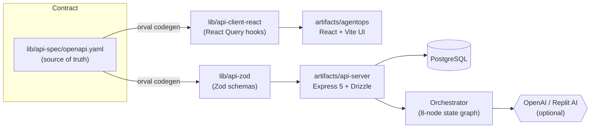
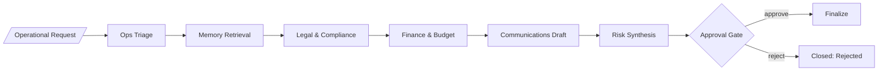

# AgentOps Command Center

> A working reference architecture for **multi-agent enterprise operations** — a
> coordinated crew of specialist AI agents that triage incoming operational
> requests, ground their reasoning in policy, run risk and budget review, draft
> communications, and land at a human approval gate with a full audit trail.

Built as a portfolio piece on Replit. Single TypeScript monorepo, Express + Drizzle
+ Postgres on the back, React + Vite + TanStack Query on the front, an OpenAPI
contract that drives both sides via codegen, and an orchestrator that runs in
deterministic **demo mode** out of the box (no API key required) and seamlessly
upgrades to **live mode** when an OpenAI key or the Replit OpenAI integration is
present.

---

## Why this exists

Operations teams at modern operating companies drown in approval queues — vendor
contracts, ad spend, hiring asks, facilities work, legal reviews. Most of the
work isn't the decision; it's assembling the evidence that lets a human make the
decision quickly and defensibly. AgentOps wires that assembly into a single
auditable pipeline of agents you can replay step by step.

"Magic" agents that produce a single black-box answer don't survive procurement,
legal, or risk review at a real company. AgentOps treats every agent action as a
first-class record: typed output, retrieved evidence, tool calls, confidence,
and the human decision that closed the loop.

---

## Core features

- **Multi-agent triage** — Ops, Legal, Finance, Communications, and Memory agents
  review every request in sequence, each producing structured output, risks, and
  confidence.
- **Human-in-the-loop approvals** — every run lands at an approval card with the
  recommendation, key evidence, and an explicit approve / reject / request-revision flow.
- **Shared memory** — keyword-search retrieval over a knowledge base of policy
  documents, with retrieved chunks surfaced as evidence on the run.
- **Tool execution** — every external call an agent makes is captured as a typed
  `tool_calls` row with input, output, status, and duration.
- **Traceable audit log** — every state transition, agent decision, and operator
  action is recorded in `activity_log`.
- **Portfolio dashboard** — five live KPIs, recent runs, and an agent health grid.
- **Deterministic demo mode** — the platform always works without an API key.

---

## Architecture





| Package                  | Role                                          |
| ------------------------ | --------------------------------------------- |
| `lib/api-spec`           | OpenAPI contract + orval config               |
| `lib/api-client-react`   | Generated React Query hooks                   |
| `lib/api-zod`            | Generated Zod schemas                         |
| `lib/db`                 | Drizzle schema, db client, migrations         |
| `artifacts/api-server`   | Express 5 server, agent orchestrator          |
| `artifacts/agentops`     | React + Vite Command Center UI                |

The orchestrator lives in `artifacts/api-server/src/orchestration/`. Each agent
step is its own node (`nodes/*.ts`); the engine walks the pipeline, persists the
result envelope, and advances `workflow_status` through the state machine
(`submitted → triaged → legal_review → finance_review → communications_draft →
approval_pending → approved/rejected → finalized`).

---

## Demo walkthrough

1. Open the **Dashboard** — five live KPIs, a Demo Story panel, recent runs, and
   an agent health grid.
2. Click **Run the demo** (or **New Request**) and submit something like
   *"Approve $48K roofing contractor for Acme HQ Q2"*. You'll be taken to the
   workflow detail.
3. Hit **Run Workflow**. The agent graph lights up node by node; the page polls
   every 1.2s while the run is in flight.
4. The **Executive Brief** card synthesizes the headline, recommendation, risk
   posture, key evidence, and next actions as soon as Risk Synthesis completes.
5. Expand any agent card to see its summary, findings, risks, recommended actions,
   tool calls, and raw JSON envelope.
6. When the run reaches **Approval**, decide from the right rail. The workflow
   finalizes (or rejects); the audit log captures every transition.
7. Visit **Approvals**, **Tool Calls**, **Knowledge**, **Agents**, **Settings**,
   and the public **/overview** case-study page to see the secondary surfaces.

---

## Demo mode vs live mode

The platform always works without an API key. When no key is configured the
orchestrator returns deterministic scenario outputs from `orchestration/demo-outputs.ts`
— a roofing contractor, marketing campaign, or hiring request each produce
realistic legal, finance, and comms output. This makes it bulletproof for
portfolio demos.

When an API key **is** present, the same `generateAgentOutput()` abstraction calls
OpenAI's chat completions API with a JSON response format and merges the LLM's
response over the demo defaults — any field the model omits gracefully falls
back. Any error in the LLM call also falls back to demo output; the pipeline
never breaks.

The mode badge in the top-right of the app reflects which path is active.

---

## Local setup

```bash
# 1. install
pnpm install

# 2. create the database schema (DATABASE_URL must be set)
pnpm --filter @workspace/db run push

# 3. seed agents, sample companies, and a couple of demo requests
pnpm --filter @workspace/api-server run seed

# 4. run everything (each in its own terminal, or use the provided workflows)
pnpm --filter @workspace/api-server run dev      # API server
pnpm --filter @workspace/agentops      run dev   # Frontend
```

On Replit the three workflows (`artifacts/agentops: web`,
`artifacts/api-server: API Server`, `artifacts/mockup-sandbox: Component
Preview Server`) start automatically.

---

## Environment variables

| Variable                            | Required | Description                                                       |
| ----------------------------------- | :------: | ----------------------------------------------------------------- |
| `DATABASE_URL`                      | yes      | PostgreSQL connection string                                      |
| `PORT`                              | yes      | Bound by Replit per artifact; do not hardcode                     |
| `AI_INTEGRATIONS_OPENAI_BASE_URL`   | optional | Set automatically by the Replit OpenAI integration                |
| `AI_INTEGRATIONS_OPENAI_API_KEY`    | optional | Set automatically by the Replit OpenAI integration                |
| `OPENAI_API_KEY`                    | optional | User-provided OpenAI key (alternative to the Replit integration)  |

If either the Replit integration env vars **or** `OPENAI_API_KEY` is present,
live mode is enabled. Otherwise the platform runs in demo mode.

> **Credential precedence:** when both are set, the Replit OpenAI integration is
> preferred over `OPENAI_API_KEY`. The integration handles billing, rotation, and
> observability for you, so it's the recommended path on Replit.

---

## Useful scripts

```bash
pnpm run typecheck                                   # full repo typecheck
pnpm run build                                       # typecheck + build all packages
pnpm --filter @workspace/api-spec run codegen        # regenerate hooks + zod from openapi.yaml
pnpm --filter @workspace/db      run push            # push schema (dev only)
pnpm --filter @workspace/api-server run seed         # reseed sample data
```

---

## Where to look first

- `lib/api-spec/openapi.yaml` — the API contract; everything is generated from here
- `artifacts/api-server/src/orchestration/engine.ts` — the workflow state machine
- `artifacts/api-server/src/orchestration/nodes/*.ts` — one file per agent
- `artifacts/api-server/src/lib/llm.ts` — demo / live mode boundary
- `artifacts/agentops/src/pages/workflow-detail.tsx` — the marquee UI surface
- `artifacts/agentops/src/pages/overview.tsx` — the public case-study page
- `replit.md` — project conventions, gotchas, and architecture decisions

---

## Future extensions

- Real vector retrieval (pgvector) behind the Memory agent's keyword fallback
- Multi-tenant auth, scoped to portfolio companies
- Configurable agent prompts and per-agent model selection
- Webhook outbound notifications on approval-gate events
- A "redo with changes" loop that lets the operator nudge the brief and re-run
  downstream agents without restarting the pipeline

---

## Portfolio positioning

AgentOps is the artifact I'd hand a procurement team or an enterprise-AI hiring
manager to answer the question *"can you build something I'd actually trust to
run inside an operating company?"*. It demonstrates:

- **Auditability over magic** — typed output envelopes, persisted evidence, and a
  full activity ledger.
- **Pragmatic stack choices** — one toolchain, generated contract, a single
  database, no premature distributed-systems theatre.
- **Graceful degradation** — works offline-first with deterministic fixtures so
  every demo lands.
- **A real product spine** — dashboard, queue, approvals, knowledge base, tool-call
  ledger, and a public case-study page, all wired through the same contract.

Built on Replit · MIT-style portfolio sample.
