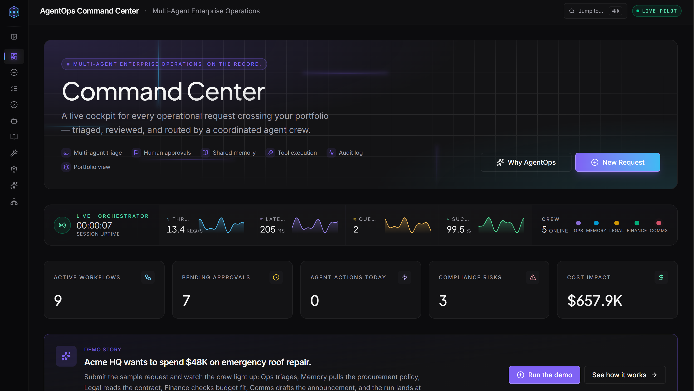
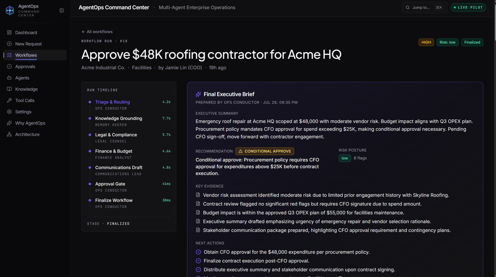
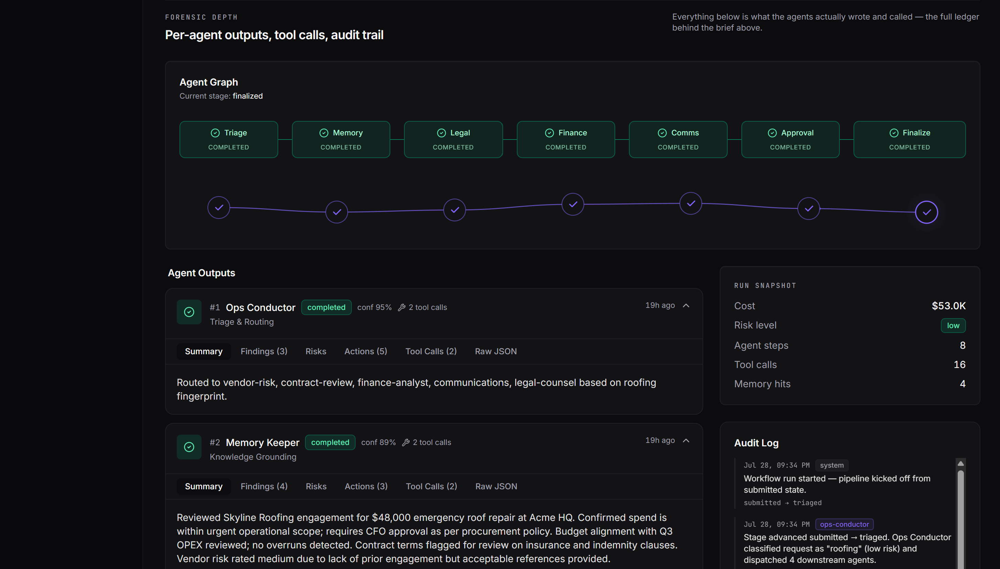
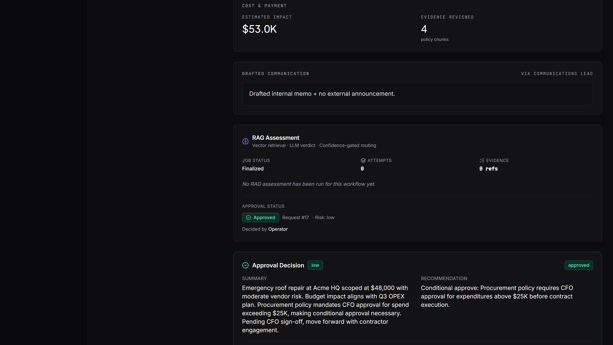

# AgentOps Command Center

A multi-agent enterprise operations platform built as a technical portfolio system. Operational requests move through an 8-node agent state machine — triaged, reviewed by specialist agents, grounded in policy memory, and routed to a human approval gate — with every agent action, tool call, and decision stored as a typed, replayable audit record.

> **Portfolio system.** API routes are not protected by authentication middleware. This demonstrates multi-agent orchestration architecture. Production deployment would require adding auth before exposing it to real users.

---

## What it demonstrates

- **Multi-stage agent orchestration** — a directed graph of specialist AI agents running in sequence, each producing a validated, structured output before passing control to the next
- **Human-in-the-loop oversight** — a formal approval gate with AI recommendation, aggregated evidence, and an explicit operator decision that closes the workflow
- **Auditability by design** — every state transition, agent output, tool call, and approval decision is persisted as a typed record and surfaced in a navigable audit trail
- **Retrieval-augmented assessment** — a separate Python service independently assesses each request against a policy knowledge base and produces a confidence-gated routing decision
- **Contract-first API** — a single OpenAPI spec drives both the generated TypeScript client hooks and the server-side Zod validators; schema drift between frontend and backend is structurally impossible
- **Dual-service coordination** — a Node.js orchestration layer and a Python FastAPI assessment service share one PostgreSQL database across two independently-migrated schemas

---

## Live Demo

**[agent-ops-command-center.replit.app](https://agent-ops-command-center.replit.app)**

Runs in deterministic demo mode by default — no API key required. Set `OPENAI_API_KEY` to switch to live LLM calls. Submit any request via **New Request** to run the full pipeline.

---

## Screenshots


*Command Center dashboard — live KPI strip, orchestrator telemetry, and agent crew status.*


*Completed workflow — run timeline with per-agent durations, final executive brief, key evidence, and next actions.*


*Forensic depth view — 8-node agent graph, per-agent structured outputs with confidence scores, run snapshot, and chronological audit log.*


*Approval panel — RAG assessment result, confidence-gated routing decision, and the operator's final approval record.*

---

## Key Features

- **8-node agent state graph** — Ops Triage → Memory Lookup → Legal Review → Finance Review → Communications Draft → Risk Synthesis → Approval Gate → Finalize
- **Typed agent output envelopes** — every node produces a validated record: summary, findings, risks, recommended actions, confidence score, raw details. Enforced by Zod at the persistence boundary
- **Demo mode / live mode duality** — every agent carries a deterministic fixture; the platform falls back gracefully when no API key is present and marks the output accordingly
- **LLM schema coercion** — `z.preprocess` coercion layer handles structural variance across model versions without hard-failing to demo
- **Human approval queue** — approve, reject, or conditionally approve with structured notes; full decision history retained
- **Policy-grounded memory** — keyword retrieval across chunked policy documents; retrieved evidence surfaced per run
- **RAG assessment pipeline** — Python service produces a confidence score and routes automatically or escalates to the human gate
- **Tool call ledger** — every agent tool call captured with input, output, status, and duration
- **Full audit log** — every state transition and operator action recorded chronologically
- **Configurable model picker** — swap LLM per-agent from the Settings UI at runtime; no code change or restart needed
- **Twilio voice bridge** — inbound calls relayed over WebSocket to the OpenAI Realtime API in real time

---

## Technical Architecture

### Frontend
React 19 SPA — Vite 7, Tailwind CSS 4, Radix UI (shadcn), TanStack Query 5, Wouter, Framer Motion. Compiled to static files served by the Node API server. All data access goes through generated TanStack Query hooks derived from the OpenAPI contract.

### Backend — Node (Orchestration API)
Express 5, TypeScript. Runs the 8-node agent state graph, persists all workflow state via Drizzle ORM, manages the approval queue, and reverse-proxies `/api-python/*` to the Python service. Routes are open — no auth middleware.

### Backend — Python (RAG + Voice)
FastAPI, Python 3.11, uvicorn. Handles retrieval-augmented assessment, request intake and triage, and a bidirectional WebSocket bridge between Twilio Media Streams and the OpenAI Realtime API.

### Database
PostgreSQL 16, two schema owners:
- **`public`** — Drizzle ORM (Node). 12 tables covering requests, runs, agent steps, tool calls, approvals, memory, knowledge, audit log, agents, settings.
- **`agentops_py`** — Alembic (Python). Assessment records and memory metadata.

### AI / Automation
OpenAI `openai` SDK (Node + Python). Default: `gpt-4.1-mini`. Available: `gpt-4.1`, `gpt-4.1-nano`, `o4-mini`. Voice: `gpt-4o-mini-realtime-preview`. Falls back to typed demo fixtures with no key present.

### External Integrations
Twilio SDK — inbound/outbound SMS; Twilio Media Streams WebSocket for voice.

### Deployment
Replit Autoscale. `scripts/start-production.sh`: Alembic migrations → Python FastAPI (background) → Node API (foreground). Health: `GET /api/healthz`.

For full architecture diagrams and sequence flows, see [docs/architecture.md](docs/architecture.md).

---

## Tech Stack

| Layer | Technology |
|---|---|
| Frontend | React 19, Vite 7, Tailwind CSS 4, Radix UI |
| State / data fetching | TanStack Query 5, Wouter |
| Animations | Framer Motion |
| Node backend | TypeScript, Express 5 |
| Python backend | Python 3.11, FastAPI, uvicorn |
| ORM | Drizzle ORM (Node), psycopg3 (Python) |
| Migrations | Drizzle Kit (Node), Alembic (Python) |
| Database | PostgreSQL 16 |
| AI SDK | openai (Node + Python) |
| Schema validation | Zod (Node), Pydantic v2 (Python) |
| API contract | OpenAPI 3.1, orval codegen |
| Telephony | Twilio SDK, Twilio Media Streams |
| Package manager | pnpm workspaces |
| Deployment | Replit Autoscale |

---

## How It Works

1. **Submit** — operator submits a request (vendor spend, contract review, headcount, etc.) with title, description, and portfolio company.
2. **Triage** — Ops Conductor classifies the request, estimates cost impact, assigns a risk level, and fingerprints it for downstream agents.
3. **Memory** — Memory Keeper performs keyword retrieval across policy documents; retrieved chunks are stored as evidence.
4. **Legal** — Legal Counsel runs compliance checks, flags contract clauses, and produces a risk assessment with confidence score.
5. **Finance** — Finance Analyst checks budget utilisation, runs a 12-month forecast, and flags spend threshold violations.
6. **Communications** — Communications Lead drafts an internal memo and external announcement with a distribution list.
7. **RAG assessment** — Python service independently retrieves policy context, calls the LLM for a structured verdict, and confidence-gates routing.
8. **Synthesis** — Ops Conductor aggregates all agent findings into a single recommended decision with blocking issues and next actions.
9. **Approval gate** — workflow lands in the operator queue. Operator reviews recommendation, evidence, risks, and tool calls; approves, rejects, or conditionally approves.
10. **Finalize** — decision recorded, audit log closed, workflow moves to terminal state.

---

## Local Development

**Prerequisites:** Node.js 22+, pnpm 10+, Python 3.11+, [uv](https://docs.astral.sh/uv/), PostgreSQL 16

```bash
# Clone
git clone https://github.com/ProdigyProjectStudios/agentops-command-center.git
cd agentops-command-center

# Node dependencies
pnpm install

# Environment
cp .env.example .env
# Edit .env — DATABASE_URL required; OPENAI_API_KEY optional

# Node schema migrations
pnpm --filter @workspace/db run migrate

# Python schema migrations
cd artifacts/agent-worker && uv run alembic upgrade head && cd ../..

# Start services (three terminals)
pnpm --filter @workspace/api-server run dev   # :8080
pnpm --filter @workspace/agentops run dev     # :20962
cd api-python && uv run python main.py        # :8008
```

Open `http://localhost:20962`. Demo mode works without an OpenAI key.

---

## Environment Variables

| Variable | Required | Description |
|---|---|---|
| `DATABASE_URL` | Yes | PostgreSQL connection string |
| `OPENAI_API_KEY` | No | Live LLM calls; demo mode used without it |
| `LLM_MODEL` | No | Model override (default: `gpt-4.1-mini`) |
| `TWILIO_ACCOUNT_SID` | No | SMS and voice features |
| `TWILIO_API_KEY` | No | Twilio API key SID |
| `TWILIO_API_KEY_SECRET` | No | Twilio API key secret |
| `TWILIO_PHONE_NUMBER` | No | Twilio sender number |
| `SESSION_SECRET` | No | Express session signing secret |
| `PORT` | No | Node API port (default: `8080`) |
| `NODE_ENV` | No | `development` or `production` |

---

## Project Structure

```
├── artifacts/
│   ├── agentops/               # React + Vite frontend
│   │   └── src/
│   │       ├── components/     # PipelineFlow, RagAssessmentPanel, StatusBadge, …
│   │       └── pages/          # dashboard, workflow-detail, approvals, agents, …
│   ├── api-server/             # Node.js orchestration API
│   │   └── src/
│   │       ├── orchestration/  # 8-node graph, node definitions, schemas, engine
│   │       ├── lib/            # BaseAgent, LLM client, model config, audit
│   │       └── routes/         # Express route handlers
│   └── agent-worker/           # Alembic migrations + Python background worker
├── api-python/                 # FastAPI RAG assessment and voice service
│   ├── main.py                 # All FastAPI route handlers
│   ├── voice.py                # Twilio ↔ OpenAI Realtime WebSocket bridge
│   └── twilio_client.py        # SMS helper
├── lib/
│   ├── db/                     # Drizzle schema + client (shared)
│   ├── api-spec/               # OpenAPI contract (source of truth)
│   ├── api-client-react/       # Generated TanStack Query hooks
│   └── api-zod/                # Generated Zod validators
├── docs/
│   ├── architecture.md         # Detailed architecture + Mermaid diagrams
│   └── screenshots/            # dashboard, workflow-detail, agent-audit-trail, approval-and-rag
├── scripts/
│   └── start-production.sh     # Production startup script
├── .github/workflows/ci.yml    # CI: typecheck, build, test, Python syntax
├── .env.example
└── pnpm-workspace.yaml
```

---

## Technical Highlights

**Contract-first API with codegen.** A single `openapi.yaml` is the authoritative source. orval generates typed TanStack Query hooks for the frontend and Zod validators for the server from it. Schema drift between the two layers is structurally impossible.

**Two isolated schema owners on one database.** The Node service owns `public` via Drizzle ORM; the Python service owns `agentops_py` via Alembic. Each migrates independently. Both schemas are created and migrated atomically at production startup before either process accepts traffic.

**Typed output envelopes enforced at the persistence boundary.** `BaseAgent` validates every LLM response against `agentOutputSchema` (Zod) before writing to `agent_steps`. No partially-shaped or unvalidated data reaches the database — regardless of which node produced the output or which model was called.

**Demo mode / live mode duality with transparent fallback.** Every agent node carries a deterministic typed demo fixture. If `OPENAI_API_KEY` is absent, the LLM call fails, or schema validation fails after coercion, the node falls back to the fixture and marks the output `fallback: "demo" | "schema_error" | "llm_error"`. The UI surfaces the fallback badge. The full pipeline is always runnable.

**LLM response coercion layer.** Newer models return structurally different JSON for the same prompt across versions. Rather than hard-failing validation and losing the LLM's reasoning, agent schemas use `z.preprocess` to coerce known variance patterns — for example, `flaggedClauses` returned as `{clause, reason}` objects rather than strings — into the expected shape before Zod validates.

**Confidence-gated routing in the RAG pipeline.** The Python assessment service retrieves policy chunks, assembles a prompt, calls the LLM for a structured verdict, and scores confidence from the response. Above threshold → auto-route to synthesis. Below threshold → escalate to human approval gate. The routing decision and evidence are visible in the RAG Assessment panel.

**Per-agent model configuration with runtime hot-swap.** Model selection resolves at call time through a four-level priority chain (per-agent DB override → global DB setting → env var → hard-coded fallback) with a 30-second in-process cache. Operators change models from the Settings UI; the next agent invocation picks up the change without a restart.

**Twilio Voice → OpenAI Realtime bidirectional bridge.** Inbound Twilio calls arrive as G.711 µ-law Media Streams over WebSocket. The Python service proxies audio frames to the OpenAI Realtime API and returns synthesised speech back to Twilio in real time, with full session management and error handling.

**Node + Python service coordination without a message broker.** The two services share state through PostgreSQL. The Node orchestrator writes workflow state; the Python service reads and writes its own assessment records in `agentops_py`. No Redis, no Kafka, no sidecar — a single database with clear schema ownership boundaries.

---

## Author

**Aaron Archer**  
AI-Native Full-Stack & Systems Engineer  
[digitalprodigy.dev](https://digitalprodigy.dev)

---

## Licence

Published as a portfolio sample. You are welcome to read and learn from this code. Do not redistribute it as your own work or use it as the basis of a commercial product without permission.
