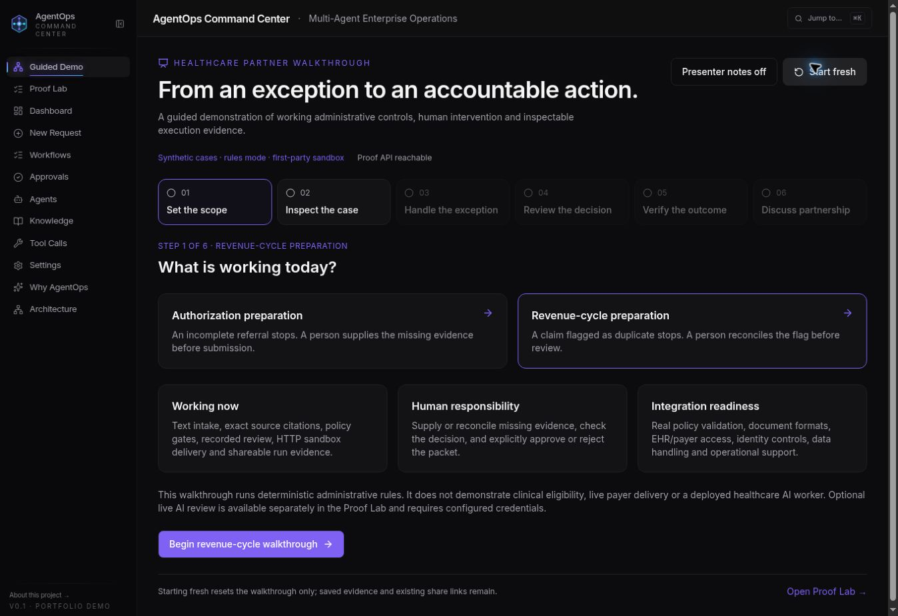

# AgentOps Command Center

**Inspect the input. Run the agents. Make the decision. Verify the outcome.**

AgentOps is a portfolio reference implementation of controlled agent workflows. It combines a TypeScript agent engine, source-level evidence, explicit human approval and saved execution records. The Proof Lab connects the original agent graph to an immutable synthetic packet and a verifiable HTTP receipt.

[Live application](https://agentops.digitalprodigy.dev) · [Guided healthcare demo](https://agentops.digitalprodigy.dev/demo/healthcare) · [Technical architecture](docs/architecture.md)

> **Synthetic portfolio system, not a production healthcare product.** The first-party sandbox does not contact a payer, EHR, bank or vendor. Proof records use browser capability keys; those are not authenticated user accounts. Legacy operational routes lack authentication middleware. Use synthetic data only.

## Start with the guided demo

Open **Overview → Start guided demo**, or choose **Guided Demo** in the sidebar. Authorization and revenue-cycle preparation each follow the same working path:

1. **Inspect the input:** view the synthetic source documents sent to the server.
2. **See the exception:** a missing supporting note or duplicate flag blocks the packet.
3. **Correct the evidence:** a person supplies or reconciles the input; a new run preserves the original blocked case.
4. **Run the agents:** execute the original seven pre-approval nodes and inspect their saved outputs and tool records.
5. **Make the human decision:** approve or reject with a note bound to both the evidence and graph fingerprints.
6. **Verify the outcome:** approval runs the final graph node and submits to the sandbox over HTTP. Independently re-read its receipt, then export or share the evidence. Rejection creates no delivery.

The walkthrough includes presenter cues, resumable tab progress and a partnership discussion. It uses **demo graph mode with zero model calls**, even if server credentials are configured. Demo narratives and estimates are preset illustrations; source checks control the packet.

The deployed site may lag the repository branch. See [PR #1](https://github.com/ProdigyProjectStudios/agentops-command-center/pull/1) for changes awaiting merge/deployment.

## What is implemented

| Capability | Inspectable evidence |
|---|---|
| Document intake | Synthetic text and text-layer PDF intake, reviewed extraction, exact line/page citations and correction provenance. PDF originals remain on the operator's device. |
| Policy checks | Deterministic gates and frozen, versioned keyword policy passages with quotes/hashes. Missing required sources block approval. |
| Original agent execution | Seven pre-approval nodes plus the final decision node; saved outputs, tool records and a graph fingerprint attached to the proof run. |
| Human control | A recorded approve/reject decision bound to the exact packet and graph snapshot. Linked workflows cannot bypass Proof Lab through legacy mutation routes. |
| HTTP delivery | Real first-party sandbox POST followed by a separate GET verification. The receipt binds the source packet and, when present, the graph. |
| Recovery | Resume interrupted graphs from saved nodes; retry approved delivery with the same run ID. An optional response-loss scenario demonstrates recovery. |
| Shareable proof | JSON exports, printable evidence packs, and expiring/revocable read-only snapshots. Review quoted content before sharing. |
| Evaluations | Saved six-case rule/live-specialist benchmarks and comparisons, separate from the original graph. |
| Optional GitHub handoff | Operator-authorized issue delivery to a configured repository, with separate integration credentials and disclosure. |
| Operational workspace | Dashboard, original requests/workflows, approval queue, knowledge, agents, tool records and model settings. |

### Execution modes and boundaries

| Mode | What actually runs |
|---|---|
| Guided demo | Deterministic evidence checks, the real Node graph engine with preset node narratives, human review and real sandbox HTTP delivery. No model calls. |
| Original graph — live AI | Six configured provider calls with full schema validation. Operator key and cost acknowledgment required. Provider/schema failures stop execution; they cannot become demo fallback proof. |
| Optional cited reviews | Separate Ops/Legal/Finance reviews over frozen source and policy evidence. Advisory output never authorizes delivery. |
| Original graph tools | `memory_search` performs real keyword retrieval. Other original graph tool records are explicitly simulated. |
| Python assessment/voice | Separate FastAPI/worker code for pgvector assessment and Twilio/OpenAI voice. These are not exercised or proven by the guided healthcare walkthrough. |

Confidence values are uncalibrated. A valid output schema does not prove factual correctness. Demo costs and narratives must not be presented as measured business results. Real payer/EHR integration, authenticated team access and production operating controls remain implementation work.

## Screenshots


*Healthcare walkthrough. Earlier capture; current code adds a dedicated original-agent execution stage before review.*


*Document evidence and saved proof records.*


*Original operational workflow with agent outputs and a human gate.*

## Architecture

- **Frontend:** React 19, Vite 7, Tailwind CSS 4, Radix UI, TanStack Query, Wouter and Framer Motion. The guided demo and evaluation pages are lazy-loaded.
- **Node API:** Express 5 and TypeScript. The original `WorkflowEngine` executes seven pre-approval nodes and a final decision node. Proof Lab attaches frozen execution snapshots to its saved packets.
- **Database:** PostgreSQL 16 with pgvector. Node's `public` schema contains 13 operational tables plus five proof tables: runs, receipts, shares, evaluations and graph links. Python owns `agentops_py` through Alembic.
- **Retrieval:** Node graph knowledge lookup and Proof Lab policy retrieval use keyword matching. The separate Python assessment/worker supports pgvector embeddings and cosine similarity retrieval with fallback reporting.
- **Contracts:** Existing operational APIs use OpenAPI-generated hooks/validators. Proof APIs use shared Zod contracts in `lib/api-zod`; they are not generated from OpenAPI.
- **Deployment:** Existing Replit Autoscale application. Production startup runs Python Alembic migrations, starts FastAPI and then Node; Node performs additive proof migrations before accepting traffic. Health endpoint: `/api/healthz`.

Graph resume is request-driven, not an automatic durable background queue. A process interruption during a provider call may require another billed call. Sandbox retries reuse the run ID; this is not a claim of exactly-once execution across arbitrary external services.

## Local development

Prerequisites: Node.js 22+, pnpm 10+, Python 3.11+, uv and PostgreSQL 16 with the vector extension enabled.

```bash
pnpm install
cp .env.example .env
# Set DATABASE_URL and load these variables into each service's environment.
pnpm --filter @workspace/db run push

# Fresh disposable development database only: seeds reference agents/data.
# Never run this seed against a deployed database containing saved records.
pnpm --filter @workspace/api-server run seed

# Migrate the Python schema from its own directory.
cd artifacts/agent-worker
uv run alembic upgrade head
cd ../..
```

Start in separate terminals with the environment loaded:

```bash
PORT=8080 pnpm --filter @workspace/api-server run dev
PORT=20962 BASE_PATH=/ API_PROXY_TARGET=http://127.0.0.1:8080 pnpm --filter @workspace/agentops run dev
PORT=8008 uv run --project api-python python api-python/main.py
```

Open `http://localhost:20962/overview`. The guided demo needs the database and five reference agents; it does not need a model key. The standalone `proof:preview` helper is for isolated QA and is not the production entry point.

### Configuration

| Variable | Purpose |
|---|---|
| `DATABASE_URL` | Required PostgreSQL connection. |
| `PORT` | API listener; use the same value for its internal sandbox receiver. Frontend Vite also requires an explicit port. |
| `BASE_PATH` | Frontend build/dev path, usually `/`. |
| `API_PROXY_TARGET` | Frontend development proxy to the Node API. |
| `OPENAI_API_KEY` | Optional provider credentials. Alternatively use `AI_INTEGRATIONS_OPENAI_API_KEY` and `AI_INTEGRATIONS_OPENAI_BASE_URL`. |
| `PROOF_INTEGRATION_KEY` | Operator secret of at least 32 characters for live graph/evaluation execution and optional GitHub handoff. Never put it in frontend environment variables. |
| `PROOF_GITHUB_REPOSITORY`, `PROOF_GITHUB_TOKEN` | Optional configured repository and server-side GitHub credential. See the handoff guide for permissions. |
| `LLM_MODEL` | Model fallback below per-agent overrides and the global database setting. |
| `WORKER_BASE_URL`, `WORKER_INGEST_SECRET` | Separate Python worker access and authenticated embedding ingestion. |
| `TWILIO_ACCOUNT_SID`, `TWILIO_API_KEY`, `TWILIO_API_KEY_SECRET`, `TWILIO_PHONE_NUMBER` | Optional separate telephony features. |

The original operational path supports labelled demo fallback. The **live proof graph** deliberately rejects provider failures instead. Provider availability in the header is not a statement that the current run used live AI.

## Validation

```bash
pnpm run typecheck
PORT=20962 BASE_PATH=/ pnpm run build
pnpm --filter @workspace/api-server test
pnpm --filter @workspace/api-server run eval
E2E_BASE_URL=http://localhost:20962 pnpm --filter @workspace/agentops run test:e2e
```

Database-dependent and browser suites require an isolated, seeded PostgreSQL database. Browser setup writes fixtures; do not target production. GitHub Actions provisions PostgreSQL 16/pgvector for these checks.

- The original-graph implementation passed **150 API tests** and **13 existing browser tests** in native CI before this presentation pass. See [CI](https://github.com/ProdigyProjectStudios/agentops-command-center/actions/runs/40981462625) and [browser checks](https://github.com/ProdigyProjectStudios/agentops-command-center/actions/runs/40981462612).
- The deterministic evaluation harness has four golden scenarios and **152 behavioral assertions**; those are assertions within the test suite, not 152 additional API tests.
- Provider transports are mocked in live-graph integration tests. These tests do not establish live model quality, production restart recovery or payer/EHR delivery.
- The presentation pass adds browser coverage for the guided graph/approval/receipt path, rejection, restored progress and mobile navigation. Current results are recorded in the PR checks and [walkthrough guide](docs/healthcare-guided-demo.md).

## Implementation guides

- [Original graph, human approval and receipt](docs/original-graph-proof.md)
- [Healthcare walkthrough and presentation notes](docs/healthcare-guided-demo.md)
- [Proof Lab setup and boundaries](docs/proof-lab.md)
- [Connected evidence and evaluations](docs/connected-proof-and-evaluations.md)
- [PDF evidence intake](docs/pdf-evidence-intake.md)
- [Recovery and printable proof packs](docs/recovery-and-proof-packs.md)
- [GitHub proof handoff](docs/github-proof-handoff.md)

## Project structure

```text
artifacts/agentops/src/       React pages, navigation and proof components
artifacts/agentops/tests/     Browser scenarios and database fixtures
artifacts/api-server/src/     Node routes, graph engine, proof services and tests
artifacts/agent-worker/       Python worker, embeddings and Alembic migrations
api-python/                  Assessment and voice FastAPI service
lib/api-zod/src/              Shared validators, proof contracts and demo scenarios
lib/db/src/schema/            Operational and proof database tables
lib/api-spec/                 Operational OpenAPI specification
lib/api-client-react/         Generated operational API client
scripts/start-production.sh   Existing Replit startup
docs/                        Implementation guides and screenshots
```

## Author and licence

**Aaron at Digital Prodigy** · AI & full-stack engineer · [digitalprodigy.dev](https://digitalprodigy.dev)

Proprietary source code, public for portfolio evaluation and technical review. Copying, redistribution, commercial use and derivative works require written permission. See [LICENSE](LICENSE).
