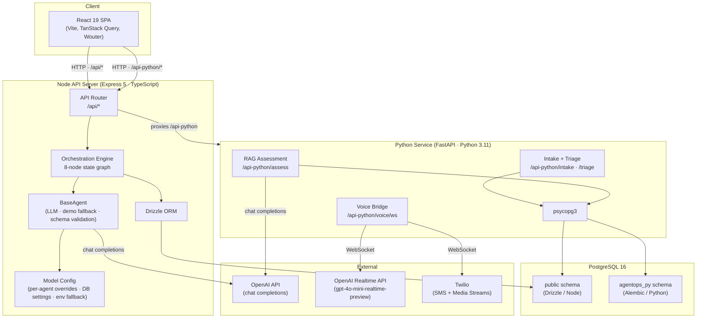
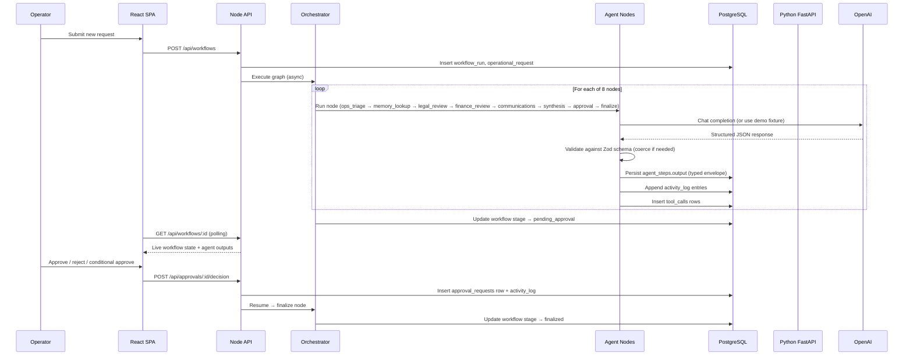

# AgentOps — Architecture Reference

This document describes the verified technical architecture of AgentOps Command Center. Every component and connection described here is implemented in the codebase.

---

## System Overview

AgentOps is a multi-service monorepo composed of three runtime processes:

| Process | Runtime | Role |
|---|---|---|
| React SPA | Static (served by Node) | Operator UI |
| Express API (`artifacts/api-server`) | Node.js / TypeScript | Orchestration, persistence, approval queue |
| FastAPI service (`api-python`) | Python 3.11 | RAG assessment, voice bridge |

All services share a single PostgreSQL database. The Node service owns the `public` schema; the Python service owns the `agentops_py` schema. Each schema is migrated independently.

---

## System Architecture Diagram



---

## Workflow Execution Sequence



---

## Agent Orchestration and Approval Flow

```mermaid
flowchart LR
    subgraph Graph["8-Node Agent State Graph"]
        A["ops_triage<br/><i>Ops Conductor</i>"]
        B["memory_lookup<br/><i>Memory Keeper</i>"]
        C["legal_review<br/><i>Legal Counsel</i>"]
        D["finance_review<br/><i>Finance Analyst</i>"]
        E["communications<br/><i>Communications Lead</i>"]
        F["synthesis<br/><i>Ops Conductor</i>"]
        G["create_approval<br/><i>Ops Conductor</i>"]
        H["finalize<br/><i>Ops Conductor</i>"]
    end

    subgraph Parallel["Parallel Python Assessment"]
        R["RAG assess<br/>(api-python)"]
        R --> RC{Confidence ≥ threshold?}
        RC -- yes --> AutoRoute["Auto-route to synthesis"]
        RC -- no --> EscRoute["Escalate to human gate"]
    end

    subgraph Human["Human Approval Gate"]
        HG["Operator reviews:<br/>recommendation · evidence · risks · tool calls"]
        HG --> D1["Approve"]
        HG --> D2["Reject"]
        HG --> D3["Conditional approve"]
    end

    A --> B --> C --> D --> E --> F --> G
    G --> Human
    Human --> H

    style Graph fill:#0f172a,stroke:#334155
    style Parallel fill:#0f172a,stroke:#334155
    style Human fill:#0f172a,stroke:#334155
```



---

## Database Schema

Managed by Drizzle ORM (`public` schema) and Alembic (`agentops_py` schema).

### public schema (Node / Drizzle)

| Table | Purpose |
|---|---|
| `operational_requests` | Source request: title, description, portfolio company, department, priority |
| `workflow_runs` | Execution instance tied to a request; carries current stage and status |
| `agent_steps` | One row per node execution; stores typed `AgentOutput` envelope as JSONB |
| `tool_calls` | Every external tool call with input, output, status, duration |
| `approval_requests` | Human approval record: decision, notes, deciding user |
| `agents` | Agent directory with slug, name, and optional `model_override` |
| `knowledge_documents` | Policy documents loaded into the knowledge base |
| `memory_chunks` | Chunked document text for keyword retrieval by the Memory Keeper |
| `activity_logs` | Chronological audit trail of every state transition and operator action |
| `portfolio_companies` | Portfolio company registry |
| `system_settings` | Key/value store for operator-configurable settings (e.g. `default_model`) |
| `users` | User table (schema present; auth enforcement not yet implemented) |

### agentops_py schema (Python / Alembic)

Assessment records and memory metadata managed by the Python FastAPI service.

---

## Agent Output Contract

Every agent node produces a typed `AgentOutput` envelope validated by `agentOutputSchema` (Zod) before being persisted:

```typescript
{
  summary: string           // one-sentence outcome
  findings: string[]        // structured observations
  risks: string[]           // flagged issues
  recommendedActions: string[]
  confidence: number        // 0.0–1.0
  details: Record<string, unknown>  // agent-specific structured data
  fallback?: "demo" | "schema_error" | "llm_error"
}
```

If the LLM call fails or the response fails schema validation (after coercion), the node falls back to a deterministic demo fixture and marks `fallback` accordingly.

---

## Memory and Retrieval

The Memory Keeper agent performs keyword search across `memory_chunks` rows to retrieve policy document segments relevant to the incoming request. Retrieved chunks are included in the agent's output `details` and surfaced as evidence in the UI.

The Python RAG assessment service (`/api-python/assess`) independently queries the same chunk store, assembles a prompt from retrieved context, calls the LLM for a structured verdict, and returns a confidence score used for routing.

There is no pgvector or approximate nearest-neighbour index in the current implementation. Retrieval is keyword-based.

---

## Model Configuration

Resolution order (highest priority wins):

1. Per-agent `model_override` stored in `agents.model_override`
2. Global default stored in `system_settings` under `default_model`
3. `LLM_MODEL` environment variable
4. Hard-coded fallback (`gpt-4.1-mini`)

The Settings UI allows operators to change the global default and per-agent overrides at runtime without restarting the service. Available models: `gpt-4.1`, `gpt-4.1-mini`, `gpt-4.1-nano`, `o4-mini`.

---

## Authentication

**Current state:** No authentication middleware is enforced on any API route. All endpoints are open. This is a portfolio demonstration system; production use would require adding auth (JWT, session, or OAuth) before deployment.

The database schema includes a `users` table with the infrastructure to support multi-user access.

---

## Deployment

- **Platform:** Replit Autoscale (stateless Cloud Run)
- **Startup:** `scripts/start-production.sh` — runs Alembic migrations → starts Python FastAPI in background → starts Node API in foreground
- **Health check:** `GET /api/healthz` (Node) and `GET /api-python/healthz` (Python)
- **Build:** TypeScript compiled with `tsc`; React SPA built with Vite; Python dependencies managed by `uv`
- **Routing:** Path-based — `/api/*` → Node, `/api-python/*` → Node proxy → Python, `/` → React SPA (static)
