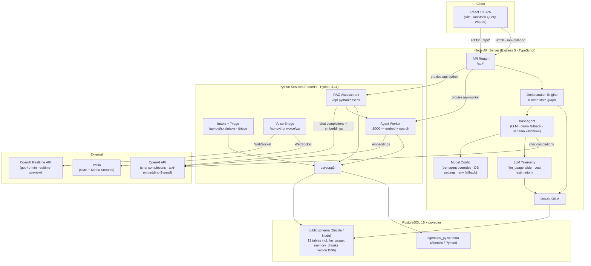
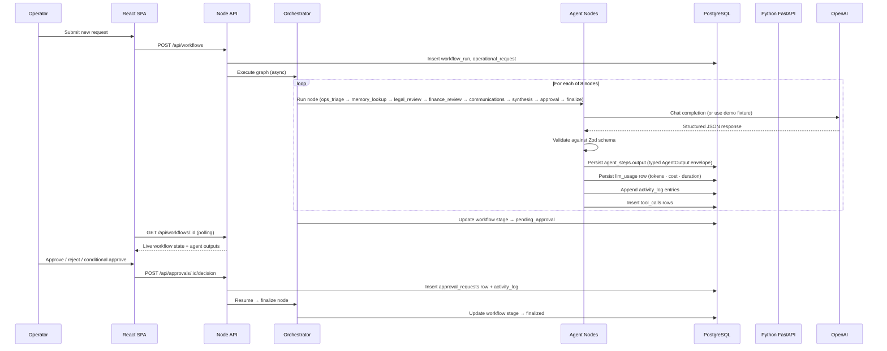
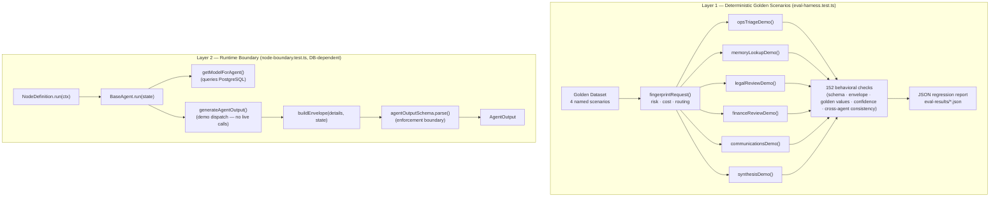
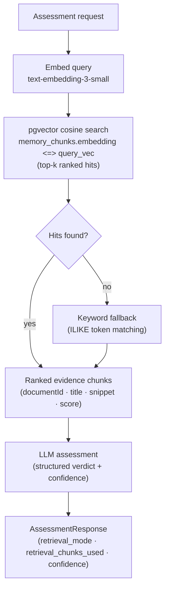
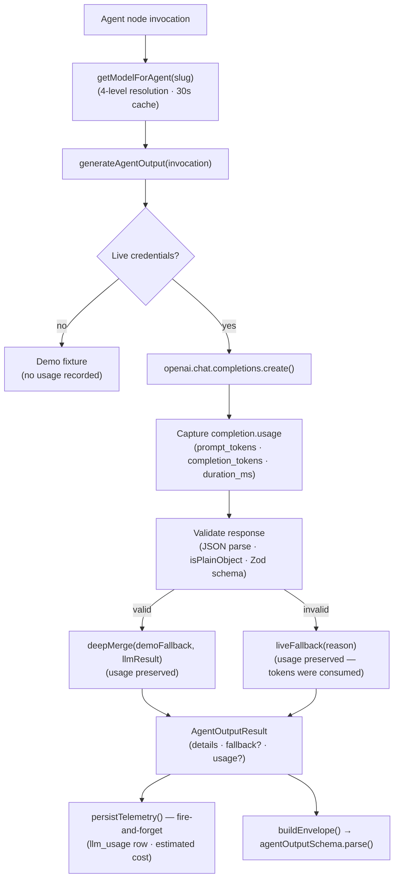

# AgentOps — Architecture Reference

This document describes the verified technical architecture of AgentOps Command Center. Every component and connection described here is implemented in the codebase.

---

## System Overview

AgentOps is a multi-service monorepo composed of three runtime processes:

| Process | Runtime | Role |
|---|---|---|
| React SPA | Static (served by Node) | Operator UI |
| Express API (`artifacts/api-server`) | Node.js / TypeScript | Orchestration, persistence, approval queue, telemetry |
| FastAPI service (`api-python`) | Python 3.11 | RAG assessment, vector retrieval, voice bridge |
| Python worker (`artifacts/agent-worker`) | Python 3.11 | pgvector embedding service, memory search, Alembic migrations |

All services share a single PostgreSQL 16 database. The Node service owns the `public` schema; the Python services own the `agentops_py` schema. Each schema is migrated independently.

---

## System Architecture Diagram



---

## Workflow Execution Sequence



---

## Agent Orchestration and Approval Flow

```mermaid
flowchart LR
    subgraph Graph["8-Node Agent State Graph"]
        A["ops_triage<br/><i>Ops Conductor</i>"]
        B["memory_lookup<br/><i>Memory Keeper</i>"]
        C["legal_review<br/><i>Legal Counsel</i>"]
        D["finance_review<br/><i>Finance Analyst</i>"]
        E["communications<br/><i>Communications Lead</i>"]
        F["synthesis<br/><i>Ops Conductor</i>"]
        G["create_approval<br/><i>Ops Conductor</i>"]
        H["finalize<br/><i>Ops Conductor</i>"]
    end

    subgraph Parallel["Parallel Python Assessment"]
        R["RAG assess<br/>(api-python)"]
        R --> RC{Confidence ≥ threshold?}
        RC -- yes --> AutoRoute["Auto-route to synthesis"]
        RC -- no --> EscRoute["Escalate to human gate"]
    end

    subgraph Human["Human Approval Gate"]
        HG["Operator reviews:<br/>recommendation · evidence · risks · tool calls"]
        HG --> D1["Approve"]
        HG --> D2["Reject"]
        HG --> D3["Conditional approve"]
    end

    A --> B --> C --> D --> E --> F --> G
    G --> Human
    Human --> H

    style Graph fill:#0f172a,stroke:#334155
    style Parallel fill:#0f172a,stroke:#334155
    style Human fill:#0f172a,stroke:#334155
```



---

## Evaluation Architecture



**Layer 1** — runs the deterministic demo decision functions directly. No DB, no server, no API key. Proves that keyword→risk mapping, cross-agent risk agreement, confidence floors, and specialist schema validity are correct for known input classes.

**Layer 2** — exercises the real production execution boundary in forced demo mode (credentials deleted before module evaluation). Proves that `buildEnvelope()`, `agentOutputSchema.parse()`, and `getModelForAgent()` behave correctly end-to-end.

**What evals prove:** deterministic behavior for known input classes.
**What they do not prove:** live LLM response quality, production semantic retrieval accuracy, or post-deployment behavioral stability.

Run with:

```bash
pnpm --filter @workspace/api-server run eval   # writes report + prints summary
pnpm --filter @workspace/api-server test       # regression assertions without report
```

---

## Retrieval Architecture (pgvector + keyword fallback)



**Key facts:**

- `memory_chunks.embedding` stores `vector(1536)` — 1536-dimensional embeddings from `text-embedding-3-small`
- pgvector extension installed via explicit Alembic migration (`CREATE EXTENSION IF NOT EXISTS vector`)
- Cosine similarity via `<=>` operator; results ranked by ascending distance
- `retrieval_mode` in the response is either `"vector"` or `"keyword"` — always reported
- `retrieval_chunks_used` is the count of evidence chunks supplied to the LLM
- Source document, category, and chunk metadata are preserved through the retrieval pipeline
- **Live path:** uses `text-embedding-3-small` via the OpenAI API. Requires `OPENAI_API_KEY` or Replit integration.
- **Test path:** deterministic fixed-dimension embeddings; tests do not prove semantic quality against real queries
- Embedding ingestion is **explicit / CLI-driven** — not automatic. New policy documents must be embedded via the backfill CLI:

```bash
cd artifacts/agent-worker
uv run python backfill_embeddings.py [--batch-size N] [--dry-run]
```

No HNSW or IVFFlat approximate-nearest-neighbour index is currently configured. Retrieval uses exact cosine distance.

---

## Live LLM Call Path



**Fallback reasons and usage retention:**

| Reason | Tokens retained? |
|---|---|
| `no_credentials` (demo mode) | No row written |
| `empty_content` | ✅ Yes — completion was received |
| `invalid_json` | ✅ Yes — completion was received |
| `schema_validation` | ✅ Yes — completion was received |
| `shape_mismatch` | ✅ Yes — completion was received |
| `api_error` (throw) | Duration only — provider may not have billed |

---

## Database Schema

Managed by Drizzle ORM (`public` schema) and Alembic (`agentops_py` schema).

### public schema (Node / Drizzle)

| Table | Purpose |
|---|---|
| `operational_requests` | Source request: title, description, portfolio company, department, priority |
| `workflow_runs` | Execution instance tied to a request; carries current stage and status |
| `agent_steps` | One row per node execution; stores typed `AgentOutput` envelope as JSONB |
| `tool_calls` | Every external tool call with input, output, status, duration |
| `approval_requests` | Human approval record: decision, notes, deciding user |
| `agents` | Agent directory with slug, name, and optional `model_override` |
| `knowledge_documents` | Policy documents loaded into the knowledge base |
| `memory_chunks` | Chunked document text with `embedding vector(1536)` for cosine similarity retrieval |
| `activity_logs` | Chronological audit trail of every state transition and operator action |
| `portfolio_companies` | Portfolio company registry |
| `system_settings` | Key/value store for operator-configurable settings (e.g. `default_model`) |
| `llm_usage` | One row per provider round-trip: model, tokens, estimated cost, duration, fallback reason |
| `users` | User table (schema present; auth enforcement not yet implemented) |

### agentops_py schema (Python / Alembic)

| Table | Purpose |
|---|---|
| `assessments` | RAG assessment records: request, retrieval_mode, confidence, verdict |
| `agent_runs` | Python-side agent execution records |
| `jobs` | Durable job queue polled by the worker loop |
| `voice_calls` | Voice call session records |
| `voice_call_events` | Per-event log for voice call sessions |
| `error_events` | Structured error records from Python services |

---

## Agent Output Contract

Every agent node produces a typed `AgentOutput` envelope validated by `agentOutputSchema` (Zod) before being persisted:

```typescript
{
  summary: string               // one-sentence outcome from buildEnvelope()
  findings: string[]            // structured observations
  risks: string[]               // flagged issues
  recommendedActions: string[]
  toolCallsRequested: ToolCallRequest[]
  confidence: number            // 0.0–1.0 (clamped by parseConfidence())
  details: Record<string, unknown>  // agent-specific structured data (specialist schema)
  fallback?: {
    mode: "demo" | "live"       // "demo" = no credentials; "live" = call attempted, then failed
    reason: "no_credentials" | "empty_content" | "non_object" | "invalid_json" | "schema_validation" | "shape_mismatch" | "api_error"
    message: string             // human-readable explanation
  }
}
```

Absent `fallback` means the live LLM response was accepted and merged. `fallback` set means the demo fixture was used — the reason explains why.

---

## Model Configuration

Resolution order (highest priority wins):

1. Per-agent `model_override` stored in `agents.model_override`
2. Global default stored in `system_settings` under `default_model`
3. `LLM_MODEL` environment variable
4. Hard-coded fallback: `gpt-4.1-mini`

Available tiers and models:

| Tier | Model |
|---|---|
| frontier | `gpt-4.1`, `o4-mini` |
| balanced | `gpt-4.1-mini` (current default) |
| fast | `gpt-4.1-nano` |

The Settings UI allows operators to change the global default and set per-agent overrides at runtime without restarting the service. The in-process cache invalidates immediately on any write; the new model is used on the next agent invocation.

This routing architecture pre-existed the telemetry sprint; it was verified and tested but not introduced by it.

---

## LLM Usage Telemetry

The `llm_usage` table (Drizzle, `public` schema) stores one row per live provider round-trip:

```
llm_usage
  id                    serial PK
  workflow_run_id       integer FK → workflow_runs (nullable)
  agent_slug            text
  provider              text ("openai")
  model                 text
  input_tokens          integer (null if provider omits usage)
  output_tokens         integer (null if provider omits usage)
  total_tokens          integer (null if provider omits usage)
  estimated_cost_micros integer (USD × 1,000,000; null for unpriced models)
  duration_ms           integer
  fallback_reason       text (null on success)
  created_at            timestamptz
```

`estimated_cost_micros: null` means pricing is not configured for that model — not that the cost was zero. The pricing catalog is in `artifacts/api-server/src/lib/llm-pricing.ts`.

Telemetry persistence is **best-effort and non-blocking**. Write failures are logged at WARN and never propagated to the agent caller. This is operational monitoring data, not a financial billing record.

Aggregation: `getRunTelemetry(workflowRunId)` in `artifacts/api-server/src/lib/telemetry.ts` returns per-agent breakdown and run totals. A null total means at least one call in the run used an unpriced model.

---

## Authentication

**Current state:** No authentication middleware is enforced on any API route. All endpoints are open. This is a technical portfolio system; a real-user deployment would require adding auth (JWT, session, or OAuth) before deployment.

The database schema includes a `users` table with the infrastructure to support multi-user access.

---

## Deployment

- **Platform:** Replit Autoscale (stateless Cloud Run)
- **Startup:** `scripts/start-production.sh` — runs Alembic migrations → starts Python FastAPI in background → starts Node API in foreground
- **Health check:** `GET /api/healthz` (Node) and `GET /api-python/healthz` (Python)
- **Build:** TypeScript compiled with esbuild via `build.mjs`; React SPA built with Vite; Python dependencies managed by `uv`
- **Routing:** Path-based — `/api/*` → Node, `/api-python/*` → Node proxy → Python, `/` → React SPA (static)
