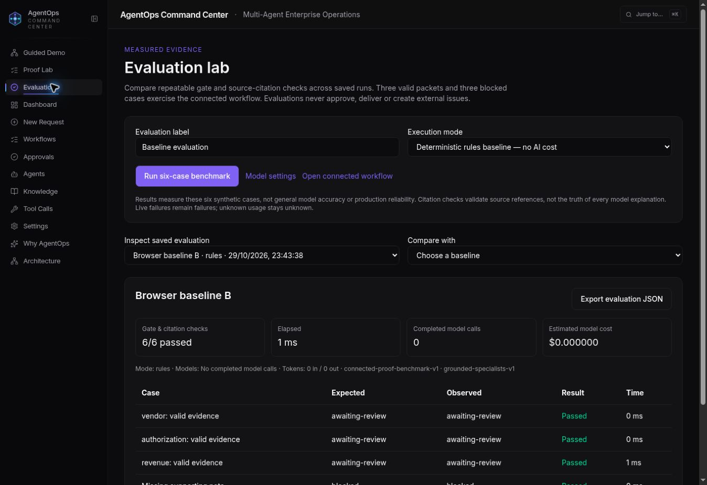

# Connected evidence workflow and evaluations

The Proof Lab now connects reviewed document evidence to a frozen policy-retrieval snapshot, optional sequential specialist reviews, human approval and the existing verified HTTP sandbox receipt. The `/evaluations` page measures six repeatable synthetic cases and saves reports in PostgreSQL.

## Scope and evidence

- Enable **Connect policy retrieval and specialist review** in `/proof-lab`. It is on for the initial invoice draft; selectable templates retain their previous defaults.
- Retrieval searches a small, versioned fictional policy catalog by literal keyword overlap. Each passage shows its exact quote, document/version, line, SHA-256 and matched terms. This is not semantic/vector retrieval and does not query the existing Knowledge database. Missing sources for any required rule block approval; an unrelated query such as `astronomy telescope` demonstrates this.
- Inputs and the retrieved snapshot contribute to the run fingerprint. Review uses the saved snapshot; changing evidence requires a new run. Deterministic rule implementations remain versioned separately.
- Rules mode makes no model calls. Live connected mode calls the configured `ops-conductor`, `legal-counsel` and `finance-analyst` models sequentially. Later reviewers receive earlier results. Every reviewer must cite valid source IDs and cover every finding; invalid/incomplete responses fail the run. Reviews are advisory, never approval. Blocked packets skip specialist calls.
- The implementation reuses the existing model configuration, provider and usage infrastructure. It does **not** execute or replace the original eight-node specialist graph. That integration remains separate work.
- The existing human approval, idempotent sandbox delivery, independent receipt verification, PDF page citations, share snapshots and printable packs remain available. Packs now include the retrieved policy passages. The optional GitHub issue adapter still requires its configured repository, token and operator key; this increment does not activate it.

## Evaluation lab

Three valid packets (invoice, authorization, revenue cycle), a missing supporting note, conflicting invoice amounts and missing policy sources are checked through the same analysis function used by saved runs. A passing case means its gate state and exact source references match expectations. It does not establish general model accuracy, calibrated confidence, clinical validity or production reliability. Model explanation truth is not scored.

Reports include dataset/prompt versions, actual returned model names, per-case outcomes/timings, completed review calls, token usage and estimated model cost. Provider errors are failures rather than successful blocks; unavailable usage remains null/unknown. A normal live benchmark performs nine specialist reviews, with additional provider requests possible through retries. The call counter counts completed reviews, not every provider attempt.

The latest 20 reports can be inspected, compared and exported as JSON. Comparisons require the same dataset version and display both execution modes. Change configured models through the existing Settings page before running a new live benchmark. Evaluations never approve packets, submit receipts or create external issues.

API additions under `/api/proof`:

| Route | Access |
| --- | --- |
| `GET /evaluations` | Browser workspace key; latest 20 owned reports |
| `POST /evaluations` | Workspace key; `mode`, `label`; live additionally requires `liveCostAcknowledged: true` and `x-proof-integration-key` |

Configure `PROOF_INTEGRATION_KEY` with at least 32 characters to permit live benchmarks. It uses the existing operator secret independently of whether GitHub is configured. The UI holds the entered key only in component memory, clears it after the request and never saves it in reports. Rules benchmarks need no new secrets. This gate is not organizational authentication; existing demo workspace limitations remain. The per-workspace concurrent-evaluation guard is process-local, not a distributed rate limiter. Reports are persisted when a synchronous benchmark finishes; interrupted benchmarks are not resumable jobs.

Startup adds only `proof_evaluations` and its owner index. Existing tables and historical evidence are preserved.

## Original graph evidence labels

New graph executions now label tool records other than the actual `memory_search` database operation as simulations, with zero fabricated execution duration and `externalActionPerformed: false`. Finalization says follow-ups were prepared instead of claiming dispatch occurred. Workflow detail displays **Confidence not calibrated** in place of the fixed confidence percentage. Historical stored rows and legacy numeric API fields are not rewritten.

## Validation — 29 October 2026

- 51 proof-focused tests pass, covering policy snapshots, missing-source blocking, three-review sequencing, invalid citations/coverage, provider failures, evaluation outcomes, operator-key enforcement, owner separation, saved reports, approval/receipt integration and existing PDF/recovery/share behavior.
- Shared-library, API and frontend type checks pass; frontend and API production builds pass.
- A broader backend run passed 131 checks; four database-dependent suites could not initialize without the seeded PostgreSQL environment. This is not a complete backend-suite pass.
- Desktop preview: two six-case rules benchmarks each passed 6/6; saved comparison and reload persistence verified. Live mode requires its operator key and cost acknowledgement before the button enables.
- Desktop preview: created a connected invoice run, expanded its exact amount-policy passage and document hash, approved it and verified the saved HTTP receipt. A second run with an unrelated policy query showed 0/6 policy sources, no approval control and no delivery.
- Live provider execution, external GitHub roundtrip, full original graph/PostgreSQL/Python integration, production restart durability and mobile viewport behavior remain unverified in this environment. No production deployment was performed.

For Replit, deploy the reviewed PR using the existing install/build process and persistent PostgreSQL configuration. Verify live provider execution and the configured external adapter after deployment; use synthetic data only.

