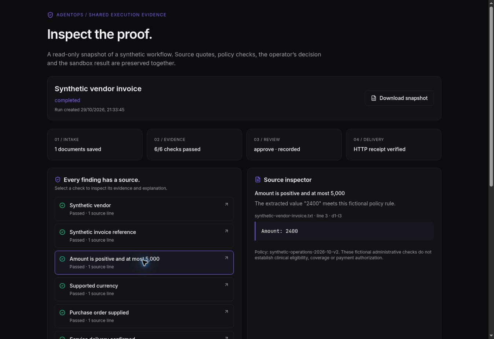

# Proof Lab: document → evidence → approval → receipt

For the latest connected retrieval, specialist-review and saved benchmark features, see [Connected evidence and evaluations](connected-proof-and-evaluations.md), including their validation and scope limits.

The Proof Lab at `/proof-lab` now executes and saves a complete synthetic administrative workflow. The original four checkbox-based examples remain at `/proof-lab/fixtures`; their legacy `/api/proof/evaluate` and `/review` APIs remain explicitly stateless simulations.

## What works

- Three document-driven workflows: vendor invoice, authorization packet and revenue-cycle packet.
- Upload `.txt` / `.md` files, text-based PDFs, or edit supplied samples. Intake accepts 1–4 documents, each at most 16,000 extracted characters (text-file limit: 16 KB; PDF limit: 5 MB / 20 pages). PDF text requires operator review, retains page references and a byte fingerprint, and offers an explicitly labelled manual-correction path. Field extraction still uses exact `Field: value` lines; OCR and arbitrary prose extraction are not implemented. See [PDF evidence intake](pdf-evidence-intake.md) for boundaries and QA.
- Every rule result links to the exact document, line number and quote. Missing and repeated fields block execution. Policies are fictional, versioned administrative rules.
- Each run saves immutable inputs, a canonical SHA-256 fingerprint, extracted fields, findings and an execution timeline in PostgreSQL. Changing evidence creates a new run requiring fresh review.
- An operator must supply a review note and approve or reject. Review re-evaluates the stored inputs and checks the fingerprint against the current policy. Approval is serialized by a row lock.
- Approval sends a real loopback HTTP POST to the authenticated first-party sandbox receiver. The receiver writes a durable ledger record. A separate HTTP GET verifies receipt identity, run ID, fingerprint and accepted fields. No payer, EHR, bank or other external service receives a submission.
- Retries use the same run ID. If the HTTP response is lost after receipt creation, retry returns the original receiver record. This prevents duplicate delivery of one run, not duplicates across distinct runs with the same invoice/claim reference. An interrupted attempt can resume after 30 seconds.
- Saved history and JSON exports include the actual run. Share links are immutable read-only snapshots, expire after seven days and can be revoked. Sharing requires explicit disclosure acknowledgment. Public snapshots include source quotes, extracted fields, review notes and receipts, but omit complete document text and the owner's workspace key. Downloaded copies cannot be recalled.

## Optional live AI review

Rules mode makes no model calls. Selecting live AI adds advisory explanations through the existing `generateAgentOutput`, `getModelForAgent("ops-conductor")` and configured provider credentials. It records the actual model, returned token counts, duration and estimated cost using the repository's price table. Prices are estimates, not billing receipts.

AI notes must reference an existing finding and source IDs belonging to that finding. Unknown or unrelated citations and invalid outputs fail the request. Missing credentials or provider fallback is never presented as live AI success. Citation validation establishes that the reference exists, not semantic correctness of every generated statement. Rule checks and human review remain authoritative.

The Proof Lab is a focused additional workflow service, using the existing application shell, database and LLM infrastructure. It does not run through or replace the existing eight-node specialist orchestration graph. The original workflows, agents, approvals, RAG and telemetry pages remain available.

## Storage and access

`proof_runs`, `proof_receipts` and `proof_shares` are additive tables registered in the Drizzle schema. The API startup runs the idempotent migration before accepting requests. The database role must permit the startup migration; check its DDL privileges before deployment. No existing table or row is modified by the migration.

Private run APIs require a random 256-bit browser workspace key (`x-proof-owner`). Only its SHA-256 hash is stored server-side. The browser persists the key in localStorage; clearing it loses access. This is a capability-based demo workspace, not verified user identity, organizational isolation or production authentication. The rest of the portfolio application's pre-existing open routes remain unchanged. Do not use real patient/confidential data.

Share tokens have 256 bits of randomness and are stored hashed. The URL fragment holds the token; the viewer sends it in `x-proof-share`, keeping it out of request URLs and referrers. Proof API responses disable caching and indexing. The public page has no application sidebar or mutation controls. Revocation prevents future retrieval; it cannot remove a snapshot already viewed/downloaded. Recorded events are not a cryptographically signed or tamper-proof audit ledger.

The sandbox receiver accepts a process-local service credential only, never browser credentials. Its destination is fixed to the same server over loopback. Multiple production replicas use their own loopback credentials and the shared PostgreSQL ledger.

## API

Types and input validators are shared via `lib/api-zod/src/proof-contract.ts` (exported from `@workspace/api-zod`). These additional routes use that shared contract directly; they are not generated by the legacy OpenAPI/orval pipeline.

| Method | Path under `/api/proof` | Access / purpose |
| --- | --- | --- |
| GET | `/templates` | Synthetic sample inputs |
| POST / GET | `/runs` | Workspace key; create or list up to 50 recent runs |
| GET | `/runs/:id` | Workspace key; complete saved run |
| POST | `/runs/:id/review` | Workspace key; fingerprint, decision, note |
| POST | `/runs/:id/retry` | Workspace key; retry approved failed/stale delivery |
| GET | `/runs/:id/receipt` | Workspace key; read receiver ledger directly |
| GET | `/runs/:id/export` | Workspace key; download complete run JSON |
| POST / GET | `/runs/:id/shares` | Workspace key; create/list shares |
| DELETE | `/runs/:id/shares/:shareId` | Workspace key; revoke a share |
| GET | `/shared` | Share token header; read immutable public snapshot |
| POST | `/sandbox/submissions` | Internal service credential; idempotent receive |
| GET | `/sandbox/receipts/:id` | Internal service credential; verify receiver record |

## Development and validation

Production uses the normal PostgreSQL `pg` pool. Hermetic integration tests use real embedded PostgreSQL via PGlite and the same SQL store, router, policy and service. This validates SQL execution and serializes concurrent requests, but is not a production PostgreSQL load/replica test.

```bash
pnpm install --frozen-lockfile
pnpm --filter @workspace/api-server test
PORT=8080 BASE_PATH=/ pnpm --filter @workspace/agentops build
pnpm proof:preview
```

The standalone preview serves the built frontend and actual proof API with a disk-backed embedded database at `/tmp/agentops-proof-preview` (override `PROOF_PREVIEW_DATA_DIR`). It does not run the broader PostgreSQL/Python application or live AI provider. The production entrypoint never imports this harness.

For Replit, merge/pull the reviewed branch, install from the lockfile, build the frontend/API and republish the existing deployment. Startup provisions the additive proof tables. No new environment variables are needed in rules mode. Verify a complete run and a shared link on the production URL after deployment. No production deployment has been performed during development.

A guided healthcare partner walkthrough is now available at `/demo/healthcare`; see [presenter flow and setup](healthcare-guided-demo.md). Saved synthetic model/rules benchmark comparisons are available at `/evaluations`. External healthcare adapters, authenticated organization workspaces and measured business outcome reporting remain follow-on work.

## Validation on 29 October 2026

- 20 proof-focused tests passed, including actual HTTP delivery/receipt verification, response-loss retry, concurrent reviews, owner separation, sharing, expiry/revocation, canonical fingerprints, citation validation and disk persistence after database reopen.
- 110 tests across the available non-boundary regression files passed. Three legacy files initially needed a DATABASE_URL merely to import their modules; rerunning them with an explicitly unused localhost URL passed their nine tests. Those runs validate their fallback/pure behavior, not a live database. The existing seeded PostgreSQL node-boundary suite was not run locally.
- Shared libraries, frontend and backend TypeScript checks passed. Frontend and API production builds passed.
- Desktop browser: uploaded a .txt invoice, inspected its cited amount, approved, verified the HTTP receipt, triggered a shared JSON download, and created/revoked links. The browser returned a download event but its file handoff was unavailable; export response contents were verified by the HTTP integration test. A missing-note authorization case blocked approval. Switching shared-link fragments was verified after a browser-discovered fix.
- No live model credentials were available, so successful provider execution is not verified. No production deployment, full existing PostgreSQL/Python stack integration test, mobile viewport test or production load test was performed.



## Recovery walkthrough and proof packs

See [Recovery and proof packs](recovery-and-proof-packs.md) for the labelled response-loss demonstration and client-facing evidence summaries.
