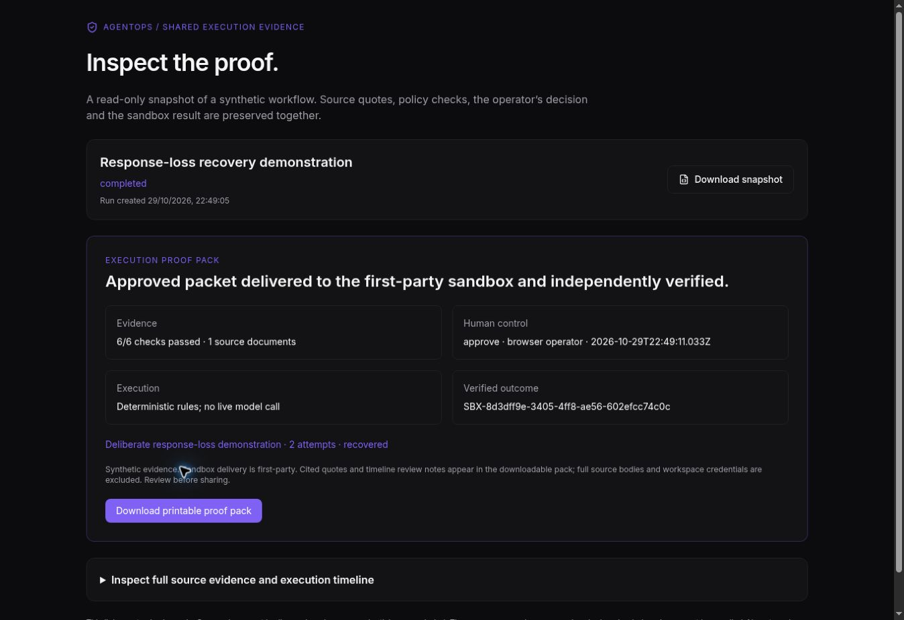

# Recovery walkthrough and client proof packs

## Present recovery

In Proof Lab, choose **Prepare recovery walkthrough**. Confirm synthetic inputs, evaluate, review the exact source lines, and approve. This creates a real first-party sandbox receipt, then explicitly discards the first response. The saved event says **Demonstration fault injected**; the run reports delivery-failed without pretending the receiver rejected it.

Use **Retry delivery** on the same saved run. The second POST uses the same run ID, so the receiver returns its original durable receipt. A separate GET verifies it, and the run completes with two attempts. **Verify receipt in receiver ledger** reads that receipt again. Automated QA asserts one receiver row and the same receipt ID; additional delivery attempts on a completed run are rejected. If an actual transport failure happens before the injected fault, the page reports that distinction.

This is a labelled synthetic fault in the first-party sandbox. It does not disrupt the live GitHub integration or any external healthcare system. The optional `recoveryDemo` flag is part of immutable run inputs/fingerprint. Existing normal runs retain normal behavior. No database schema migration is needed.

## Give a prospect inspectable proof

Every owned saved run now has an execution proof card. Completed, blocked and rejected runs can use the existing disclosed, revocable seven-day link. The shared page leads with the outcome, evidence-check count, human decision, model usage/cost when present, receipt and recovery result. Source citations and the full timeline remain available under **Inspect full source evidence and execution timeline**. GitHub handoff status is shown separately when present.

**Download printable proof pack** generates standalone HTML with print styles, citations, policy version, fingerprint, timeline and any external handoff result. Open it and use the browser's print-to-PDF facility if a PDF is needed. All dynamic content is escaped; its CSP disallows scripts, network requests and form submission. Full source bodies and workspace keys are omitted. Quotes and review notes are included, so the owner must review contents before distributing. Downloaded copies cannot be revoked; hosted share links can. Existing shared snapshots keep their frozen evidence while gaining the new presentation.

No time savings, external delivery, verified human identity or compliance claims are fabricated. Incomplete runs are explicitly shown as having no completed outcome.

## Validation and remaining activation

34 proof tests pass, including real HTTP sandbox intake/recovery, persistence, one receiver row, shared snapshots and HTML escaping/omission checks. Shared-library/frontend/backend typechecks and builds pass; the existing main-bundle size warning remains. The new pack tests passed again after moving pure rendering into the shared contract library.

Desktop preview browser QA completed: prepare recovery case, explicit approval, labelled first-attempt failure, successful retry, receiver receipt recheck, share creation, shared proof pack, refresh, and evidence drill-down. QA used the production proof service/router/store with embedded PostgreSQL; production Replit was not republished or restarted. The browser download monitor timed out, so delivery of the HTML download to the user's filesystem is not verified, despite passing HTML-generation tests. Full mobile/download/restart QA remains outstanding.

The GitHub handoff is implemented but not live-activated: this environment has none of `PROOF_GITHUB_REPOSITORY`, `PROOF_GITHUB_TOKEN` or `PROOF_INTEGRATION_KEY`, and no Replit secret-management connector. Configure these privately in Replit following `docs/github-proof-handoff.md`, then republish and run a synthetic external handoff. Never put token values in chat or the repository.
